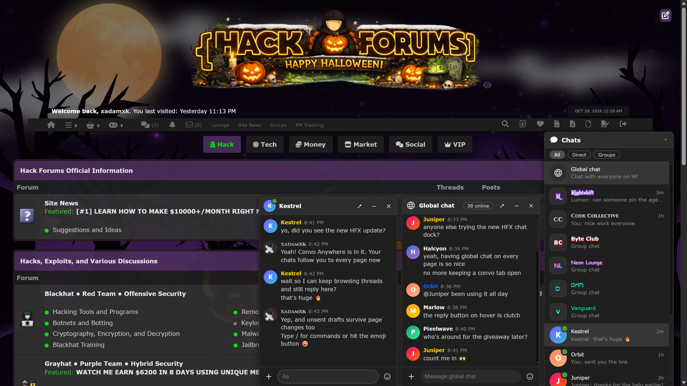
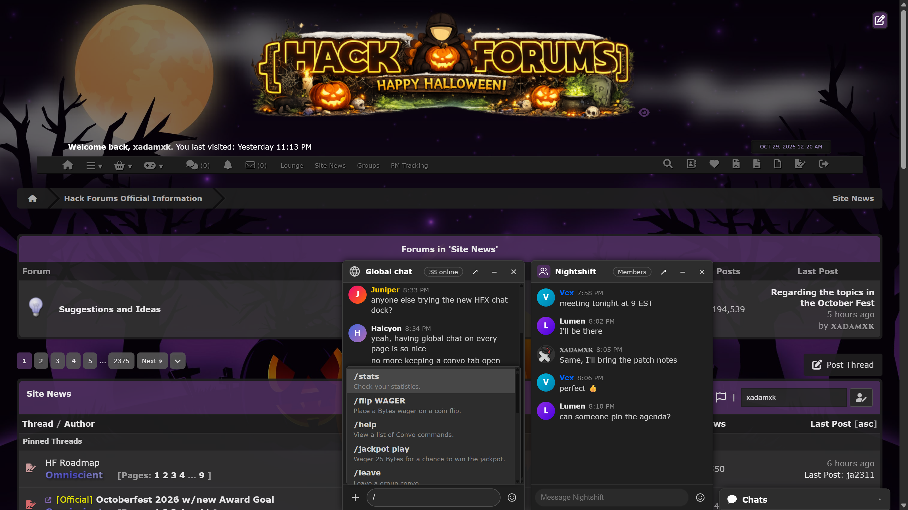
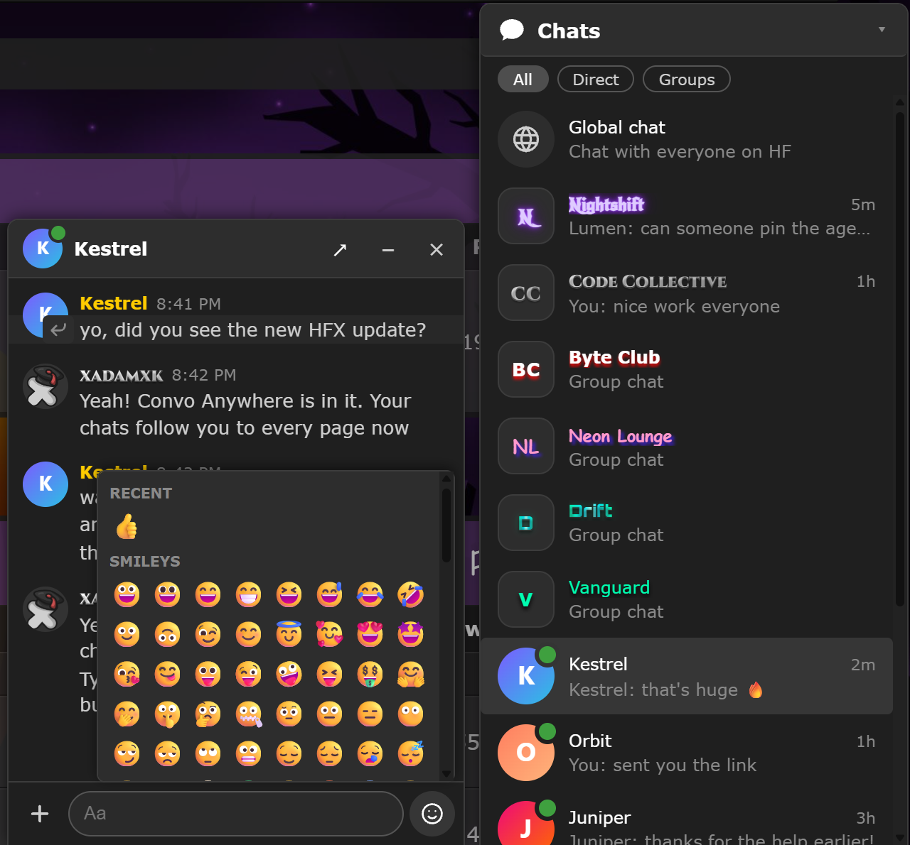
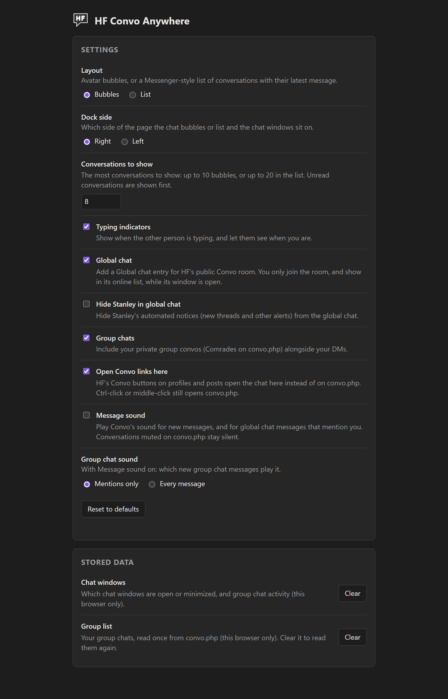

<h1>HF Convo Anywhere</h1>
Chat in Convo from anywhere on HackForums - your DMs, group chats and the global chat in a Messenger-style dock
   
   
  

 
  
Chats on Any Page:

  

 
  
Global Chat, Group Chats and Commands:

  

 
  
Replies and Emoji:

  

 
  
Bubbles Layout:

  

 
  
Group Chat Bubbles:

  

 
  
Settings:

  

