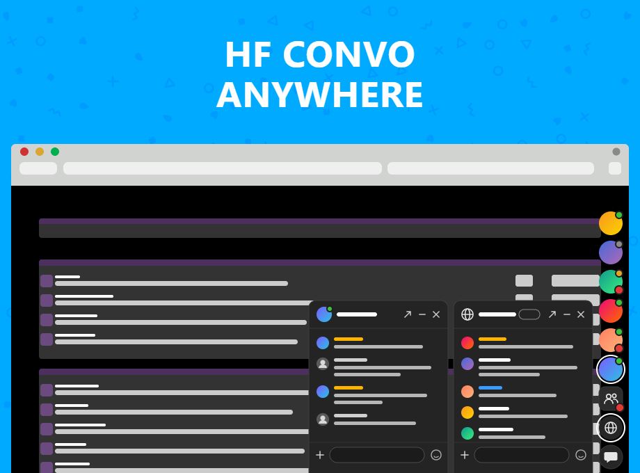
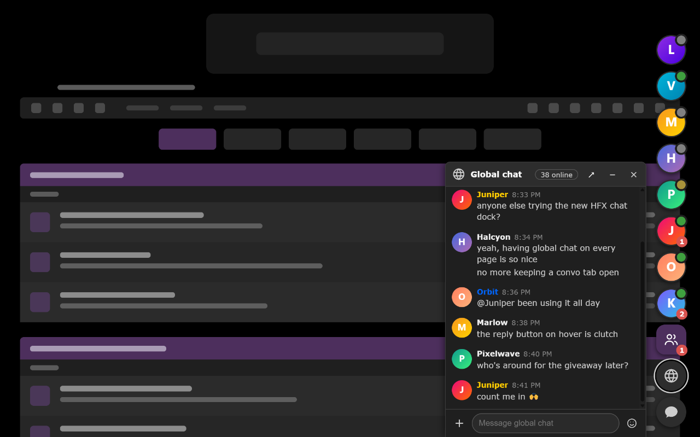
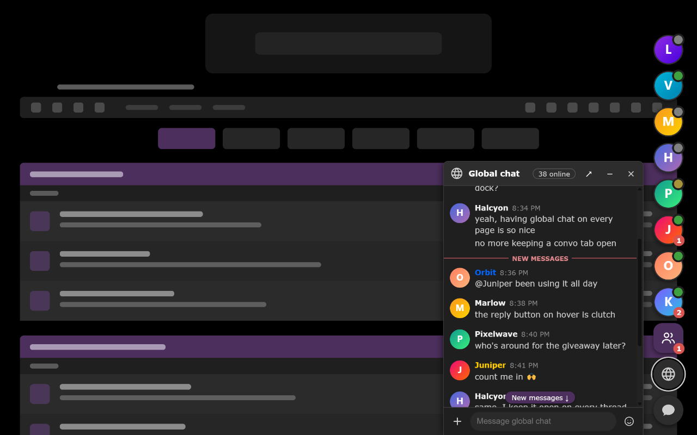
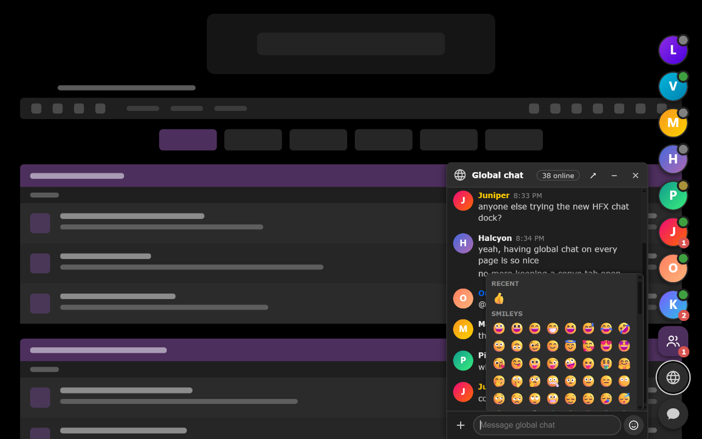
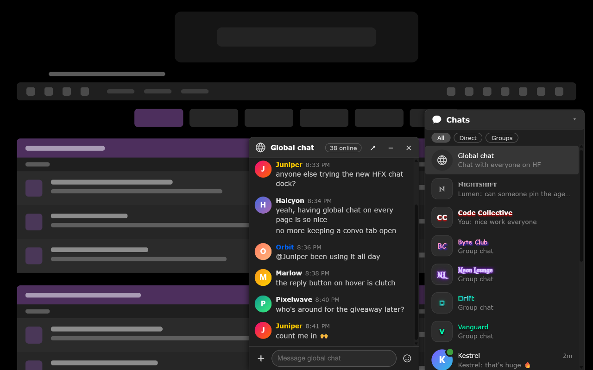
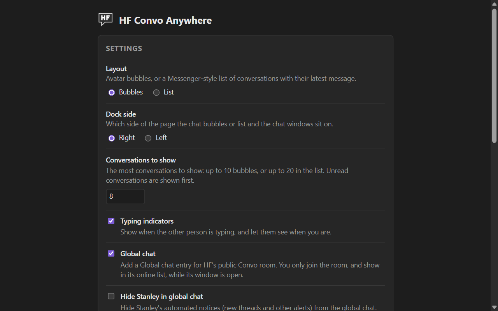

<h1>HF Convo Anywhere</h1>
Chat in Convo from anywhere on HackForums - your DMs, group chats and the global chat in a Messenger-style dock
   
   
  

 
  
Bubbles and Global Chat:

  

 
  
New Messages:

  

 
  
Emoji Picker:

  

 
  
List Layout:

  

 
  
Settings:

  

